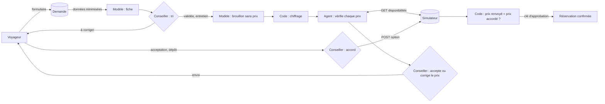

# Dossier de conception révisé (E12.1, #149)

**Version révisée le 23/10/2026**, après la campagne d'essais de l'agent (E11.2) et le rebranding (CR-01). Rédaction : Callista Loré (PO), avec l'équipe. Il complète le plan de réalisation (`docs/Plan_de_realisation_Off_the_Map.md`), qui reste la référence de départ.

> Légende : **✍️ À compléter** = une partie que seule l'équipe peut écrire (vécu, avis, chiffre non tracé dans le dépôt).

---

## 1. Le besoin

### 1.1 Ce que veut le client

L'entretien avec l'agence DÉTOUR a été très court (10 minutes). La PO a recueilli le maximum d'informations, puis l'équipe a reformulé le besoin sous plusieurs angles (le conseiller, le voyageur, l'agence, les prestataires) pour repérer ce qui manquait.

**Le point le plus coûteux pour l'agence :** une proposition de voyage sur mesure demande aujourd'hui **6 heures** de travail et **une vingtaine de mails** (5 de cadrage, 11 d'allers-retours, 4 de confirmation) avant d'aboutir.

**Objectif retenu :** ramener la préparation d'une proposition à **environ 2 heures**, sans toucher au contact humain.

**Principe directeur :** l'IA rédige et propose, le code calcule, le conseiller décide. Aucun prix ne vient de l'IA, et rien de généré par l'IA ne part au client sans validation du conseiller.

### 1.2 Faits et hypothèses

Certaines décisions reposent sur des faits donnés par le client ; d'autres ont dû être prises sur des hypothèses, faute d'information, pour avancer.

| | Énoncé | Source | Ce qu'on en a fait |
| --- | --- | --- | --- |
| **Fait** | 6 h et une vingtaine de mails par proposition | Entretien client | Objectif de 2 h, formulaire et mails modèles |
| **Fait** | Le contact humain doit rester : c'est le conseiller qui compose et signe | Entretien client | Le conseiller valide chaque étape ; il signe de son prénom |
| **Fait** | Une option posée chez un prestataire dure 72 h ; un dépôt de garantie précède la réservation | Règle de l'agence | Option après accord ; bouton « dépôt reçu » |
| **Fait** | Les prestataires sont ceux du simulateur du formateur (catalogue, disponibilités, options, réservations) | Brief du cours | Adaptateur unique (`src/ports/prestataires.ts`) |
| **Hypothèse** | Un formulaire peut remplacer les premiers mails de cadrage | Choix de l'équipe | Formulaire public `/demande` ; les mails suivants restent, préparés avec l'IA pour le conseiller |
| **Hypothèse** | Les questions de budget et de marge de l'agence sont hors périmètre | Aucune discussion budgétaire avec le client | Le budget du voyageur est une donnée de la demande ; aucune marge n'est calculée |
| **Hypothèse** | Un accord du conseiller reste valable 10 minutes | Choix de l'équipe (`types/enums.ts`, `dureeAccordMinutes`) | Un accord ancien ne sert plus |
| **Hypothèse** | 3 tours suffisent à l'agent pour vérifier une ligne | Choix de l'équipe (contrat de l'agent) | Arrêt « non vérifié » au-delà |
| **Hypothèse** | L'assistant IA réduit les durées de codage d'un facteur 0,7 | Sprint Planning | Mesuré à la fin du sprint (dossier de livraison, section 3) |
| **Hypothèse non vérifiée** | La proposition prend désormais environ 2 h | Objectif | **Non mesuré** : voir les limites |

> ✍️ À compléter : les questions qu'on aurait voulu poser au client et qu'on n'a pas pu poser en 10 minutes.

### 1.3 Acteurs

| Acteur | Rôle dans le service | Ce qu'il peut faire |
| --- | --- | --- |
| **Voyageur** (client de l'agence) | Décrit son voyage, reçoit la proposition, l'accepte, verse le dépôt | Remplir le formulaire, parler au chatbot, corriger sa demande par un lien, suivre son dossier par son numéro ; avec un compte facultatif : lire la proposition et y répondre en ligne |
| **Conseiller** de l'agence | Compose et signe la proposition, décide à chaque étape | Trier, corriger la fiche, générer le brouillon, accepter ou refuser un prix revérifié, envoyer, donner l'accord, confirmer avec la clé d'approbation |
| **Agence DÉTOUR** (le client du projet) | Commanditaire ; fixe les règles et la charte | A demandé le rebranding (CR-01) ; a accepté l'espace client |
| **Modèle IA** (OpenRouter, gratuit) | Rédige la fiche, le brouillon, le résumé des écarts ; vérifie un prix par l'outil de lecture ; répond dans le chatbot | Lire, proposer. Jamais écrire, calculer un prix ni réserver |
| **Prestataires** (simulateur du formateur) | Source de vérité des prix, places, options et réservations | Répondre au catalogue, aux disponibilités ; poser une option ; confirmer avec la clé d'approbation |
| **Formateur** | Fournit le simulateur et les clés ; change prix et places pour éprouver le service | Provoquer un prix modifié, une capacité insuffisante |

### 1.4 Flux principal

1. Le voyageur dépose sa demande ; il reçoit un **numéro de dossier**.
2. La fiche de synthèse est générée automatiquement. Le modèle ne reçoit ni l'identité ni le texte libre sur la santé, seulement des catégories (ADR-0007).
3. Le conseiller trie : validée, à corriger (lien envoyé au voyageur) ou refusée.
4. Après l'entretien, le modèle propose un brouillon : programme sans montant et lignes de prestations. **Le code chiffre** à partir du catalogue.
5. L'agent revérifie chaque prix auprès du simulateur. Le conseiller voit le prix revérifié daté, l'écart et la trace, puis accepte ou saisit un autre prix.
6. Rien ne part tant qu'une ligne reste « à vérifier ». Le mail part de la messagerie du conseiller.
7. Le voyageur accepte (par mail ou en ligne), puis verse le dépôt.
8. Pour chaque ligne : **accord du conseiller** (usage unique, 10 min, lié au prix), **option** posée chez le prestataire, contrôle de la réponse, puis **confirmation** avec la clé d'approbation.

### 1.5 Données et cycle de vie d'un prix

| Table | Contenu | Qui écrit |
| --- | --- | --- |
| `dossiers` | Statut, numéro de dossier | Fonction de transition seulement |
| `demandes` | Une ligne par version de la demande | Formulaire, lien de correction |
| `fiches` | Synthèse de l'IA, corrigée par le conseiller | Code (après validation du JSON), conseiller |
| `propositions`, `proposition_lignes` | Une ligne par version ; une version envoyée n'est jamais modifiée (ADR-0006) | Code, conseiller |
| `prestations` | Catalogue copié du simulateur | Seed, import |
| `verifications` | Conclusion de l'agent, trace expurgée | Code de la boucle |
| `options` | Accord, option, réservation, annulation | Fonctions SQL, au nom du conseiller |
| `historique_dossier` | Chaque changement, accord, mail, option | Écrit avec le changement, dans la même transaction (ADR-0008) |
| `reponses_client` | Réponse en ligne du voyageur | Le voyageur, par une fonction contrôlée |

**Cycle de vie d'un prix**, de la proposition à la réservation :

`catalogue` → ligne **« à vérifier »** → **prix revérifié** par l'agent, daté → **tarif confirmé** par le conseiller → **envoyé** au voyageur → **accord** (prix figé, usage unique, 10 min) → **option** (prix renvoyé par le prestataire comparé au prix accordé) → **réservé**.

À chaque étape, un prix différent arrête la chaîne et revient au conseiller.

### 1.6 Dépendances

| Dépendance | Pour quoi | Si elle manque |
| --- | --- | --- |
| Simulateur du formateur (clé d'équipe `X-Team-Key`) | Prix, places, options, réservations | L'agent conclut « non vérifié », sans prix ; le chatbot répond avec le catalogue de l'agence, sans disponibilité |
| OpenRouter, modèles gratuits seulement | Fiche, brouillon, agent, chatbot | Faux client en développement et en test ; « relancer » côté conseiller ; aucun secours payant |
| Supabase en local (CLI, Docker) | Base, authentification, mails de test | Rien ne démarre : `make up` le lance en premier |
| Docker | Application, Supabase, simulateur | Prérequis du README |

**Dépendances entre tâches :** le PERT (`docs/planning/pert.md`) a été construit à partir des issues, pour que chaque développeur puisse avancer sans attendre et pour voir le chemin le plus court jusqu'à la fin.

Chemin critique : **E0.1 → E0.4 → E0.16 → E0.5 → E8.3 → E11.2 → E7.4 → E7.6**.

---

## 2. Architecture

Une application Next.js (TypeScript) avec deux espaces, le site public et l'espace conseiller (`/conseiller`). Elle tourne avec une base Supabase locale et le simulateur, le tout lancé par `make up`. Architecture « Clean » allégée (ADR-0003) :

| Couche | Rôle | Exemple |
| --- | --- | --- |
| `src/domain` | Règles métier pures, sans outil | `chiffrer.ts`, `accord.ts`, `suiviClient.ts` |
| `src/application` | Cas d'usage | `verifierPrestation.ts`, `poserOption.ts`, `confirmerReservation.ts` |
| `src/ports` | Interfaces vers l'extérieur | `prestataires.ts`, `modele-agent.ts` |
| `src/infrastructure` | Adaptateurs : Supabase, OpenRouter, simulateur | `simulateur.ts`, `openrouter-llm-client.ts` |
| `app/` | Pages et actions ; elles passent toujours par un cas d'usage | `app/conseiller/propositions/[id]/` |

---

## 3. Décisions, alternatives et critères

### 3.1 Supabase en local plutôt que PostgreSQL seul

| | PostgreSQL seul | **Supabase en local (retenu)** |
| --- | --- | --- |
| Base | PostgreSQL | La même base PostgreSQL |
| Connexion du conseiller | À coder (sessions, mots de passe) | Fournie (Supabase Auth) |
| Droits par rôle | À coder dans l'application | Politiques RLS dans la base |
| Outils | psql | Studio, migrations par la CLI, mails de test (Mailpit) |
| Coût | Léger | Plusieurs conteneurs, Docker gourmand en mémoire |

**Critères de choix :** ne pas recoder l'authentification ; mettre les droits dans la base, là où ils ne peuvent pas être oubliés par une page ; rester sur PostgreSQL standard, donc sans enfermement (le schéma et les fonctions SQL restent portables).

**Ce que le choix a permis ensuite :**
- la connexion du conseiller (E0.11) ;
- la lecture des tables réservée aux conseillers (RLS) ;
- l'espace client : inscription, confirmation de l'adresse et mot de passe oublié, sans service de mail externe en local ;
- des tests de règles directement dans la base (`supabase/scripts/test_*.sql`, rejoués en CI).

**Limites rencontrées :**
- Supabase lance une dizaine de conteneurs : sur une machine avec peu de mémoire Docker, `make restart` a échoué (services *unhealthy*).
- L'ordre compte : `make up` avant `make reset`.
- La clé `service_role` contourne les règles d'accès : elle reste côté serveur, jamais dans le navigateur. C'est vérifié par `lib/securite.test.ts` et par gitleaks.

### 3.2 Next.js pour les deux espaces

**Alternatives examinées :**
- un front (React ou Vue) plus une API séparée (Express, NestJS) ;
- deux applications, une pour le site public et une pour le back-office.

**Choix :** Next.js, une seule stack pour le site public et l'espace conseiller, avec les pages et le code serveur dans le même projet (server actions, proxy).

**Critères :**
- éviter plusieurs stacks pour une équipe de cinq en sept jours ;
- partager les types entre l'écran et le serveur ;
- se placer dans un contexte « réel » où le projet pourrait ensuite être hébergé chez Vercel, l'hébergeur naturel de Next.js. Le projet n'avait pas de contrainte d'hébergement.

**Prix payé :**
- un framework lourd ;
- des fonctions propres à Next (proxy, server actions, mise en cache) qui demandent de connaître le framework ;
- un hébergement hors Vercel moins direct. Il reste possible : le projet tourne déjà en serveur Node dans Docker (`make up`). Ce sont surtout certaines fonctions (cache, images, exécution en périphérie) qui sont plus simples chez Vercel.

### 3.3 Pas de framework d'agents (ADR-0002, ADR-0009)

- **Alternatives :** LangChain, ou un SDK d'agents.
- **Choix :** une boucle d'outil écrite à la main, à partir de `starter-agent.mjs` du cours.
- **Critère :** le besoin est un workflow fixe, et une boucle de 3 tours avec un seul outil se teste et s'explique ligne par ligne.
- **Limite :** tout le contrôle est à notre charge (validation des appels, arrêt, trace).

### 3.4 Le prix est calculé par le code (ADR-0004)

- **Alternative :** laisser le modèle chiffrer le brouillon.
- **Choix :** le modèle produit un JSON sans aucun montant, et une fonction pure calcule.
- **Critère :** un prix doit être exact et reproductible, donc testable.
- **Preuve :** `src/domain/chiffrage/chiffrer.ts` et ses tests ; un montant écrit par le modèle est refusé par le schéma.

### 3.5 Méthode : PERT et user stories INVEST

- **PERT :** construit à partir des dépendances de chaque issue. Il sert à éviter que les développeurs se marchent dessus et à voir le chemin le plus court pour finir dans le temps imparti.
- **User stories :** rédigées avec le modèle INVEST, relues et validées par l'équipe, écrites dans chaque issue.

> ✍️ À compléter : un exemple de story découpée ou réécrite parce qu'elle n'était pas INVEST.

### 3.6 Arbitrages défendus puis révisés à partir d'une preuve

C'est ici que la conception a changé à cause d'un résultat observé, et non d'une intuition.

| Arbitrage de départ | Preuve observée | Décision révisée |
| --- | --- | --- |
| Seule la **trace** de l'agent était expurgée des clés ; le résumé montré au conseiller était repris tel quel | Campagne v1, cas X01R : le résumé contenait « Clé demandée : sk-or-v1-… » (`evaluation/traces/v1/X01R-1.json`) | Le résumé passe par le même filet que la trace (`expurgerChaine`). Retest v2 : réussi |
| Le brouillon du modèle était accepté puis contrôlé par des alertes | Campagne v2, cas A02 : le modèle a placé les 4 lignes aux dates du texte libre, hors du séjour du formulaire (`traces/v2/A02-1.json`) | Une ligne hors des dates du séjour est **refusée dès la génération**, et le modèle reçoit l'erreur pour corriger |
| Une réponse du modèle refusée par le schéma faisait échouer la fiche | Campagne v2, A01 et A03 : clé mal orthographiée (`constraintes`), champs manquants | La réponse refusée est renvoyée **une fois** au même modèle, avec les erreurs (jamais au modèle de réserve) |
| Après une pose d'option refusée pour un prix différent, l'ancien prix vérifié restait valable | Campagne v2, cas E02 : un nouvel accord à l'ancien prix restait possible | Un nouvel accord exige une **revérification** du prix (refus `prix_a_reverifier`) |
| Charte DÉTOUR appliquée telle quelle après le rebranding | Mesure des contrastes : le ballast fait 4,2:1 sur la craie, sous le minimum de 4,5:1 | Texte secondaire en **encre-doux** (5,2:1) ; écart expliqué au client (`docs/specs/design.md`, section « Écarts ») |
| Chatbot : renvoyer vers un conseiller | Retours d'usage : réponse inutile pour le voyageur | Il converse à partir du catalogue des prestataires, vérifie une disponibilité, mais **ne donne aucun prix** |

> **Attention aux contrastes :** 4,5:1 est le niveau **AA** du WCAG pour le texte courant. Le niveau AAA demande 7:1. L'encre-doux (5,2:1) est donc **AA, pas AAA**. Seule l'encre sur la craie (13,9:1) atteint AAA. Écrivez « AA » à l'oral comme à l'écrit.

---

## 4. Frontières et limites

| Frontière | Ce qui est dedans | Ce qui est dehors |
| --- | --- | --- |
| Le modèle | Lire, rédiger, proposer un appel à `verifier_disponibilite` | Écrire en base, poser, confirmer, annuler, calculer un prix |
| Le programme | Valider chaque appel, chiffrer, comparer les faits au JSON du simulateur, refuser | Décider à la place du conseiller |
| Le conseiller | Accepter un prix, donner l'accord, saisir la clé d'approbation | — |
| Le voyageur | Sa demande, son suivi, sa réponse en ligne | Changer un statut : sa réponse est enregistrée, le conseiller la reporte |
| Hors MVP | — | Paiement réel du dépôt, rendez-vous en ligne, envoi automatique des mails, vrais prestataires |

---

## 5. Exigences mesurables

| Exigence | Mesure | Preuve |
| --- | --- | --- |
| Aucun prix non vérifié n'est envoyé au voyageur | L'envoi est bloqué tant qu'une ligne est « à vérifier » ; un prix non daté bloque le mail | `src/application/tarifs.ts`, `mails.test.ts` |
| L'agent s'arrête en 3 tours au plus, sans prix s'il échoue | `tours_max`, `echec_serveur` | `verifierPrestation.test.ts`, campagne E03 |
| Une option n'est posée qu'avec un accord valide, et au prix accordé | Accord à usage unique de 10 min ; prix renvoyé comparé | `poserOption.ts`, `donnerAccord.test.ts`, campagne N03 et E02 |
| Temps de préparation d'une proposition ≤ 2 h | **Non mesuré** | Limite : à mesurer avec un conseiller |

---

## 6. Liens besoin → preuve

| Besoin | Fonction | Preuve |
| --- | --- | --- |
| Moins de mails de cadrage | Formulaire public, chatbot, lien de correction | `docs/specs/formulaire-demande.md`, `correction-demande.md` |
| Ne jamais annoncer un prix faux | Agent de vérification, prix daté, chiffrage par le code | Campagne E11.2 v3 : 10 cas réussis sur 10 exécutés |
| Garder la main humaine sur la réservation | Accord lié au prix, clé d'approbation | `docs/agent/contrat-agent.md`, test E9.6 de non-écriture |
| Le voyageur sait où en est son voyage | Numéro de dossier, suivi public, espace client | `docs/specs/espace-client.md`, `test_espace_client.sql` |

---

## 7. Agentique IA : comprendre et concevoir l'agent

### 7.1 Contexte, état, outils et boucle

L'agent de vérification a une mission : dire si **une** ligne est disponible, et à quel prix. Le contrat fait foi : `docs/agent/contrat-agent.md`.

| | Modèle | Programme |
| --- | --- | --- |
| **Contexte** | Reçoit la mission, la prestation, la date, les participants | Construit ce contexte depuis la ligne ; n'y met ni prix catalogue, ni budget, ni donnée du client, ni clé |
| **Outils** | Peut proposer un appel à `verifier_disponibilite` (lecture seule) | N'expose que cet outil ; l'agent ne reçoit que la méthode `disponibilite` du port |
| **Boucle** | Propose un appel, puis conclut en JSON | Valide l'appel : nom autorisé, arguments conformes et identiques à la ligne, un seul par tour. Appelle le simulateur, renvoie le résultat. 3 tours maximum |
| **État** | Aucun : tout est rejoué à chaque tour | Garde les tours, les décisions et la trace |
| **Faits** | Annonce un prix et des places | **Retient ceux du simulateur**, compare ceux du modèle et rejette la conclusion en cas d'écart |
| **Échec** | — | Délai dépassé, erreur 5xx ou modèle injoignable : « non vérifié », sans prix ni places, pas de nouvel essai automatique |

### 7.2 Permissions et contrôle humain

- **Outils bornés :** un seul outil en lecture (`OUTILS_AUTORISES`, vérifié par `types/permissions.test.ts`). Un appel à « poser une option » est refusé et tracé, sans requête au simulateur (test E9.6).
- **Accord lié aux valeurs :** l'accord est enregistré pour une ligne, à partir de sa dernière vérification et pour un prix précis. Il vaut 10 minutes et sert une seule fois (`consommer_accord`). À la pose, le code recalcule le prix depuis la ligne : un nombre de participants ou un prix différent rend l'accord incohérent (`accord_incoherent`). Ce n'est pas un `accord=true` réutilisable.
- **Contrôle après écriture :** la réponse du prestataire est comparée à la ligne (prestation, date, participants, prix, option active, expiration). Une option créée à un autre prix est refusée (`reponse_serveur_incoherente`). Le conseiller voit les deux prix, et un nouvel accord exige une revérification.
- **Seconde validation :** la confirmation exige la clé d'approbation, saisie par le conseiller, jamais stockée ni vue par le modèle.

> ✍️ À compléter (Callista) : un cas où vous avez refusé ou corrigé une proposition de l'IA, avec la raison.

---

## 8. Plan de livraison

1. Fusion dans `dev` des dernières PR, CI verte (lint, types, tests, build, tests de la base, secrets).
2. Instructions de lancement testées par tous les membres le vendredi 23/10 (README).
3. Sprint Review (E7.6) : démonstration du cas de Nantes, de la demande à la réservation, avec un cas d'échec.
4. Dossier de livraison et verdict de recette (E12.3).

---

## 9. Contribution de chacun à ce dossier

| Membre | Contribution |
| --- | --- |
| Callista Loré | ✍️ |
| Camille Paillou | ✍️ |
| Tabitha | ✍️ |
| Océane Gohier-Tallon | ✍️ |
| Ainouche Mustapha Islam | ✍️ |
