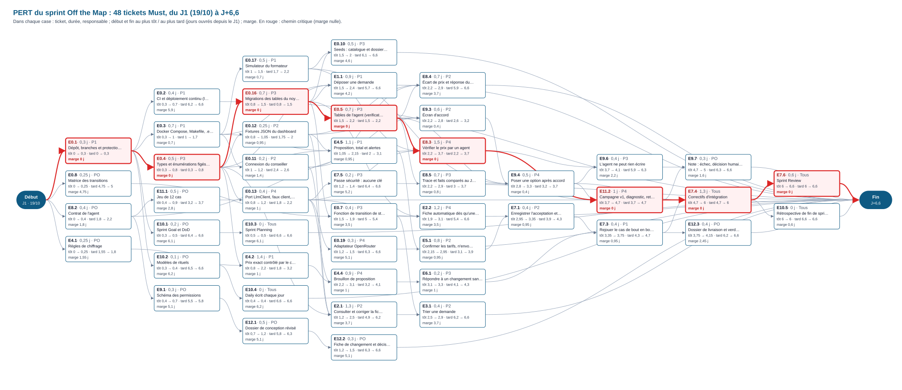

# PERT du sprint

**Sprint unique, du J1 (lundi 19/10/2026) à la Sprint Review.** Construit à partir des issues : durées (« charge »), responsables et dépendances (« Bloquée par ») tels qu'écrits dans chaque issue, relues une à une le 20/10/2026. Les 48 tickets Must forment le réseau ; les Should et Could, hors sprint, sont listés à part.

Lecture : une colonne par étape (un ticket est placé juste après le dernier de ses prédécesseurs). Dans chaque case : ticket, durée, responsable ; **début et fin au plus tôt**, **début et fin au plus tard**, en jours ouvrés depuis le J1 ; **marge**. En rouge : le chemin critique.

## Chemin critique

**E0.1 → E0.4 → E0.16 → E0.5 → E8.3 → E11.2 → E7.4 → E7.6**, soit **6,6 jours** du J1 à la fin de la Sprint Review.

| Ticket | Pourquoi il est critique |
| --- | --- |
| E0.1 → E0.4 → E0.16 | dépôt, types, migrations : tout le reste en dépend |
| E0.5 | tables de l'agent (vérifications, options) |
| E8.3 | l'agent de vérification, la plus longue tâche (1,5 j) |
| E11.2 | la campagne de 12 cas, qui attend l'agent, la trace et l'option |
| E7.4 → E7.6 | correctifs d'intégration puis Sprint Review, toute l'équipe |

Un jour de retard sur l'un de ces tickets décale la Sprint Review d'un jour. Les autres tickets ont une marge (colonne « Marge ») : ils peuvent glisser d'autant sans rien retarder.

## Dates au plus tôt et au plus tard

Triées par début au plus tôt. Jours ouvrés comptés depuis le début du J1 (J+0 = lundi 19/10 au matin).

| Ticket | Issue | Titre | Resp. | Durée | Début au plus tôt | Fin au plus tôt | Début au plus tard | Fin au plus tard | Marge |
| --- | --- | --- | --- | ---: | ---: | ---: | ---: | ---: | ---: |
| E0.1 | #79 | Dépôt, branches et protections | P1 | 0,3 j | J+0 | J+0,3 | J+0 | J+0,3 | **0 (critique)** |
| E4.1 | #102 | Règles de chiffrage | PO | 0,25 j | J+0 | J+0,25 | J+1,55 | J+1,8 | 1,55 j |
| E8.2 | #122 | Contrat de l'agent | PO | 0,4 j | J+0 | J+0,4 | J+1,8 | J+2,2 | 1,8 j |
| E0.8 | #87 | Matrice des transitions | PO | 0,25 j | J+0 | J+0,25 | J+4,75 | J+5 | 4,75 j |
| E0.4 | #82 | Types et énumérations figés dans /types | P3 | 0,5 j | J+0,3 | J+0,8 | J+0,3 | J+0,8 | **0 (critique)** |
| E0.3 | #81 | Docker Compose, Makefile, .env.example et squelette Next.js | P1 | 0,7 j | J+0,3 | J+1 | J+1 | J+1,7 | 0,7 j |
| E0.2 | #80 | CI et déploiement continu (lint, types, tests, build, secrets, Vercel) | P1 | 0,4 j | J+0,3 | J+0,7 | J+6,2 | J+6,6 | 5,9 j |
| E10.1 | #134 | Sprint Goal et DoD | PO | 0,2 j | J+0,3 | J+0,5 | J+6,4 | J+6,6 | 6,1 j |
| E10.2 | #135 | Modèles de rituels | PO | 0,1 j | J+0,3 | J+0,4 | J+6,5 | J+6,6 | 6,2 j |
| E11.1 | #146 | Jeu de 12 cas | PO | 0,5 j | J+0,4 | J+0,9 | J+3,2 | J+3,7 | 2,8 j |
| E9.1 | #127 | Schéma des permissions | PO | 0,3 j | J+0,4 | J+0,7 | J+5,5 | J+5,8 | 5,1 j |
| E10.4 | #137 | Daily écrit chaque jour | Tous | 0 j | J+0,4 | J+0,4 | J+6,6 | J+6,6 | 6,2 j |
| E10.3 | #136 | Sprint Planning | Tous | 0 j | J+0,5 | J+0,5 | J+6,6 | J+6,6 | 6,1 j |
| E12.1 | #149 | Dossier de conception révisé | PO | 0,5 j | J+0,7 | J+1,2 | J+5,8 | J+6,3 | 5,1 j |
| E0.16 | #83 | Migrations des tables du noyau | P3 | 0,7 j | J+0,8 | J+1,5 | J+0,8 | J+1,5 | **0 (critique)** |
| E0.12 | #91 | Fixtures JSON du dashboard | P2 | 0,25 j | J+0,8 | J+1,05 | J+1,75 | J+2 | 0,95 j |
| E0.13 | #92 | Port LlmClient, faux client, minimisation | P4 | 0,4 j | J+0,8 | J+1,2 | J+1,8 | J+2,2 | 1 j |
| E4.2 | #103 | Prix exact contrôlé par le code | P1 | 1,4 j | J+0,8 | J+2,2 | J+1,8 | J+3,2 | 1 j |
| E0.17 | #142 | Simulateur du formateur | P1 | 0,5 j | J+1 | J+1,5 | J+1,7 | J+2,2 | 0,7 j |
| E0.11 | #90 | Connexion du conseiller | P2 | 0,2 j | J+1 | J+1,2 | J+2,4 | J+2,6 | 1,4 j |
| E4.5 | #106 | Proposition, total et alertes | P1 | 1,1 j | J+1,05 | J+2,15 | J+2 | J+3,1 | 0,95 j |
| E2.1 | #97 | Consulter et corriger la fiche | P2 | 1,3 j | J+1,2 | J+2,5 | J+4,9 | J+6,2 | 3,7 j |
| E12.2 | #150 | Fiche de changement et décision | PO | 0,3 j | J+1,2 | J+1,5 | J+6,3 | J+6,6 | 5,1 j |
| E0.19 | #143 | Adaptateur OpenRouter | P4 | 0,3 j | J+1,2 | J+1,5 | J+6,3 | J+6,6 | 5,1 j |
| E7.5 | #119 | Passe sécurité : aucune clé | P3 | 0,2 j | J+1,2 | J+1,4 | J+6,4 | J+6,6 | 5,2 j |
| E0.5 | #84 | Tables de l'agent (verifications, options) | P3 | 0,7 j | J+1,5 | J+2,2 | J+1,5 | J+2,2 | **0 (critique)** |
| E0.7 | #86 | Fonction de transition de statut | P3 | 0,4 j | J+1,5 | J+1,9 | J+5 | J+5,4 | 3,5 j |
| E1.1 | #95 | Déposer une demande | P1 | 0,9 j | J+1,5 | J+2,4 | J+5,7 | J+6,6 | 4,2 j |
| E0.10 | #89 | Seeds : catalogue et dossiers de démonstration | P3 | 0,5 j | J+1,5 | J+2 | J+6,1 | J+6,6 | 4,6 j |
| E2.2 | #98 | Fiche automatique dès qu'une demande arrive | P4 | 1,2 j | J+1,9 | J+3,1 | J+5,4 | J+6,6 | 3,5 j |
| E5.1 | #107 | Confirmer les tarifs, n'envoyer que des prix vérifiés | P2 | 0,8 j | J+2,15 | J+2,95 | J+3,1 | J+3,9 | 0,95 j |
| E8.3 | #123 | Vérifier le prix par un agent | P4 | 1,5 j | J+2,2 | J+3,7 | J+2,2 | J+3,7 | **0 (critique)** |
| E9.3 | #129 | Écran d'accord | P2 | 0,6 j | J+2,2 | J+2,8 | J+2,6 | J+3,2 | 0,4 j |
| E8.5 | #125 | Trace et faits comparés au JSON | P3 | 0,7 j | J+2,2 | J+2,9 | J+3 | J+3,7 | 0,8 j |
| E4.4 | #105 | Brouillon de proposition | P4 | 0,9 j | J+2,2 | J+3,1 | J+3,2 | J+4,1 | 1 j |
| E8.4 | #124 | Écart de prix et réponse du serveur | P2 | 0,7 j | J+2,2 | J+2,9 | J+5,9 | J+6,6 | 3,7 j |
| E3.1 | #99 | Trier une demande | P2 | 0,4 j | J+2,5 | J+2,9 | J+6,2 | J+6,6 | 3,7 j |
| E9.4 | #130 | Poser une option après accord | P4 | 0,5 j | J+2,8 | J+3,3 | J+3,2 | J+3,7 | 0,4 j |
| E7.1 | #115 | Enregistrer l'acceptation et le dépôt reçu | P2 | 0,4 j | J+2,95 | J+3,35 | J+3,9 | J+4,3 | 0,95 j |
| E6.1 | #110 | Répondre à un changement sans perdre la version envoyée | P3 | 0,2 j | J+3,1 | J+3,3 | J+4,1 | J+4,3 | 1 j |
| E7.3 | #117 | Rejouer le cas de bout en bout | P1 | 0,4 j | J+3,35 | J+3,75 | J+4,3 | J+4,7 | 0,95 j |
| E11.2 | #147 | Campagne v1, diagnostic, retest v2 | P4 | 1 j | J+3,7 | J+4,7 | J+3,7 | J+4,7 | **0 (critique)** |
| E9.6 | #132 | L'agent ne peut rien écrire | P3 | 0,4 j | J+3,7 | J+4,1 | J+5,9 | J+6,3 | 2,2 j |
| E12.3 | #151 | Dossier de livraison et verdict de recette | PO | 0,4 j | J+3,75 | J+4,15 | J+6,2 | J+6,6 | 2,45 j |
| E7.4 | #118 | Correctifs d'intégration | Tous | 1,3 j | J+4,7 | J+6 | J+4,7 | J+6 | **0 (critique)** |
| E9.7 | #133 | Note : échec, décision humaine, conception révisée | PO | 0,3 j | J+4,7 | J+5 | J+6,3 | J+6,6 | 1,6 j |
| E7.6 | #120 | Sprint Review | Tous | 0,6 j | J+6 | J+6,6 | J+6 | J+6,6 | **0 (critique)** |
| E10.5 | #138 | Rétrospective de fin de sprint | Tous | 0 j | J+6 | J+6 | J+6,6 | J+6,6 | 0,6 j |

Charge totale des Must : 25,85 jours-personne (PO comprise), pour un chemin critique de 6,6 jours : le travail en parallèle à quatre développeurs et une PO est indispensable.

## Hors sprint (Should et Could)

Ils ne sont pas dans le réseau : on les prend seulement si quelqu'un est libre, sans toucher au chemin critique.

| Ticket | Issue | Titre | Priorité | Durée | Dépend de |
| --- | --- | --- | --- | ---: | --- |
| E0.15 | #94 | Script create_issues.py | should | 0,1 j | E0.1 |
| E1.2 | #96 | Corriger ma demande depuis un lien | should | 1 j | E1.1 |
| E5.4 | #144 | Mails modèles (mailto) | should | 0,4 j | E3.1, E5.1 |
| E3.3 | #101 | Comprendre ce que je dois corriger | should | 0,8 j | E3.1, E5.4, E1.2 |
| E5.2 | #108 | Remplacer une ligne indisponible | should | 0,2 j | E5.1 |
| E6.2 | #111 | Voir ce qui a changé entre deux versions | should | 0,8 j | E6.1 |
| E6.3 | #112 | Résumer les écarts en mots | should | 0,2 j | E6.2 |
| E6.4 | #113 | Rappel quand un client ne répond pas | should | 0,4 j | E5.1 |
| E6.5 | #114 | Abandonner un dossier sans réponse | could | 0,4 j | E6.4 |
| E9.5 | #131 | Seconde validation avant confirmation | should | 0,4 j | E9.4 |
| E9.8 | #145 | Annuler une réservation | could | 0,3 j | E9.5 |
| E11.3 | #148 | Mode rejeu | should | 0,3 j | E11.2 |

## Méthode

- **Durées** : charge de chaque issue. Pour 21 tickets, elle diffère du plan v6 (voir [`../rituels/sprint-planning.md`](../rituels/sprint-planning.md)) : le PERT suit les issues, à recalculer une fois les estimations confirmées par l'équipe.
- **Dépendances** : « Bloquée par » de chaque issue. E0.1 (#79) est compté avec 0,3 j.
- **Calcul** : début au plus tôt = fin la plus tardive des prédécesseurs ; au plus tard en remontant depuis la fin ; marge = début au plus tard − début au plus tôt ; chemin critique = tickets de marge nulle.
- **Hypothèse** : chaque ticket démarre dès que ses prédécesseurs sont faits (capacité suffisante). Les tickets « Tous » à 0 j (rituels) sont des jalons.

## Relevé de la relecture des issues

- **Issues encore ouvertes alors que leur PR est fusionnée dans `dev`** : E0.4 #82, E0.8 #87, E0.10 #89, E1.1 #95, E1.2 #96, E2.2 #98, E3.1 #99, E3.3 #101, E4.1 #102, E5.1 #107, E5.4 #144, E8.2 #122, E9.1 #127, E10.1 #134, E11.1 #146. Les PR visent `dev` : « Closes #… » ne ferme l'issue qu'à la fusion dans la branche par défaut. À fermer à la main.
- **Textes dépassés par le plan v6** : E0.2 #80 (Vercel ; on reste sur Docker), E2.2 #98 (« secret partagé » ; plus de webhook, ADR-0005), E3.1 #99 (« go » devient « validée »), E7.1 #115 (« passe le dossier à gagnée » ; acceptation puis dépôt, le dossier est gagné quand tout est réservé), E9.4 #130 (option de 2 jours ouvrés ; règle de 72 h), E0.10 #89 et E7.3 #117 (« dossier de Sophie » ; cas de Nantes).
- **Dépendance à vérifier** : E7.3 #117 ne dépend dans l'issue que d'E6.1 et E7.1, alors que le plan le fait dépendre de tout le parcours (E1.1, E2.2, E3.1, E4.4, E5.1, E8.4, E9.3, E9.4, E9.5). Avec les dépendances du plan, E7.3 passerait après E9.4.
- **#152** n'a pas pu être lu.
