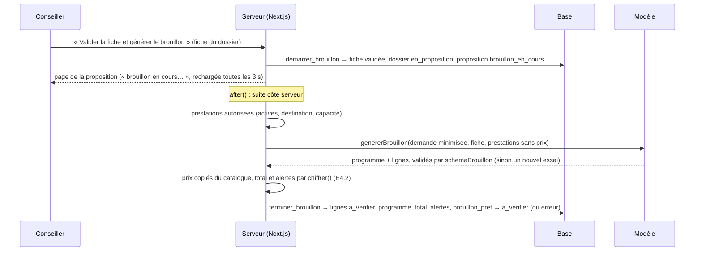

# Brouillon de proposition (E4.4)

**Règle** : le modèle propose, le code chiffre. Cas d'usage : `src/application/genererBrouillon.ts`. Base : `supabase/migrations/20261020200000_brouillon_proposition.sql`. Lancement en arrière-plan : `lib/proposition/generation.ts` (ADR-0005, comme la fiche).

## Parcours

## Ce que le modèle reçoit, et ce qu'il ne reçoit pas

| Reçu | Jamais |
| --- | --- |
| `DemandePourLLM` (destination, dates et nuits **de référence**, voyageurs, budget de référence, envies, contraintes, catégories de régime, mobilité) | nom, e-mail, notes du conseiller |
| la fiche (`FicheIA` : envies, contraintes, points flous, régimes, mobilité, niveau physique) | prix des prestations |
| `{ id, nom, type }` des prestations autorisées par le code | prestations inactives, d'une autre destination ou trop petites pour le groupe |

Dates, nuits et budget de référence : la fiche corrigée l'emporte sur la demande (`valeursDeReference`, E4.2).

## Ce que le code garantit

- Une prestation hors de la liste fournie, plus de participants que de voyageurs ou un montant dans le texte : réponse non conforme (`schemaBrouillon`), **aucune ligne écrite**.
- Prix unitaire = copie figée du catalogue (`prix_unitaire_catalogue_cents`) ; total et alertes calculés par `chiffrer()`. Toutes les lignes naissent au statut `a_verifier`.
- Lignes, programme, total, alertes et les deux transitions sont écrits dans **une seule transaction** (`terminer_brouillon`).
- Un seul nouvel essai après un échec du modèle (aucun si le modèle n'est pas configuré) ; ensuite la proposition passe en `erreur` et le conseiller peut **relancer** (`erreur → brouillon_en_cours`).
- Le libellé d'échec ne cite jamais la réponse du modèle. Il n'est pas stocké en base : l'écran affiche « la génération du brouillon a échoué ».
- Les prestations écartées par le modèle (`ecartes`) ne sont pas enregistrées.

## Démarrage (`demarrer_brouillon`)

| Dossier | Résultat |
| --- | --- |
| `entretien_fait`, fiche avec budget réel et dates fixes | fiche validée (`validee_par`, `validee_le` si absents), dossier `en_proposition` au nom du conseiller, proposition v1 `brouillon_en_cours` |
| `entretien_fait`, fiche incomplète | refus `OT005` (« renseignez le budget réel et les dates fixes ») |
| `en_proposition`, sans proposition | proposition `brouillon_en_cours` |
| déjà une proposition | refus `OT004` |
| autre statut | refus `OT002` |

Le dossier est verrouillé : deux clics simultanés ne créent qu'une proposition. Une nouvelle version après envoi relève d'E6.1.

## Contrat du dashboard

`Proposition` (`types/dashboard.ts`) gagne `programme` : `[{ date, titre, texte }]`, `null` tant que le brouillon n'est pas écrit. Fixtures mises à jour.

## Tests

`src/application/genererBrouillon.test.ts` (filtre du catalogue, prix et total par le code, minimisation, échecs et nouvel essai, réponse non conforme, relance) ; `supabase/scripts/test_contraintes.sql` (démarrage, refus, écriture tout ou rien, droits).
