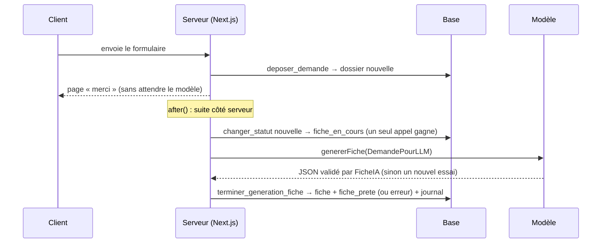

# Génération automatique de la fiche (E2.2)

**Décision** : ADR-0005, génération asynchrone **sans webhook**. Cas d'usage : `src/application/genererFiche.ts`. Base : `supabase/migrations/20261020160000_generation_fiche.sql`. Lancement : `lib/fiche/generation.ts`.

## Parcours

## Règles

| Règle | Choix | Où c'est garanti |
| --- | --- | --- |
| Déclenchement | L'enregistrement de la demande lance la génération **dans le conteneur de l'application**, après la réponse au client (`after()` de Next.js). Pas de webhook, donc pas de route publique ni de secret partagé à vérifier | `app/demande/actions.ts` → `genererEnArrierePlan` |
| Un seul lancement | Le dossier passe de `nouvelle` à `fiche_en_cours` par la fonction de transition, ligne verrouillée : de deux appels simultanés, l'autre reçoit `statut_modifie` et s'arrête, sans appeler le modèle | `changer_statut` (OT002) ; `lancerGenerationFiche` → `deja_lancee` |
| Une seule fiche | `unique (demande_id)` sur `fiches`, et la fin de génération n'aboutit que si le dossier est encore en `fiche_en_cours` | `terminer_generation_fiche` (OT002) |
| Données envoyées | `DemandePourLLM` seulement : catégories de régime et de mobilité, jamais le nom ni l'e-mail | `versDemandePourLLM` (type marqué, schéma strict) |
| Validation | Réponse validée par `FicheIA` dans l'adaptateur, avant toute écriture ; un montant dans un texte est refusé | `types/ia.ts` |
| Nouvel essai | Un échec (délai, fournisseur, réponse non conforme) donne lieu à **un** nouvel essai. Pas de nouvel essai pour une erreur de configuration | `ESSAIS_MAX = 2` |
| Échec | Après le second échec : dossier en `erreur`, libellé court sur la fiche (`erreur_generation`), jamais le message brut. Une fiche précédente garde son contenu | `terminer_generation_fiche` ; `enregistrer_generation_fiche` (E2.1) |
| Correction de la demande | Après le renvoi depuis le lien (E1.2), le dossier est en `fiche_en_cours` : la fiche de la nouvelle version est générée de la même façon | `app/demande/corriger/[jeton]/actions.ts` |
| Relancer | Le bouton « relancer » (E2.1) repasse le dossier en `fiche_en_cours` au nom du conseiller, puis relance la génération | `app/conseiller/dossiers/[id]/actions.ts` |
| Atomicité | Fiche, statut et journal sont écrits ensemble, ou rien | `terminer_generation_fiche` → `changer_statut` |
| Traçabilité | Modèle noté sur la fiche (`modele`) ; pour OpenRouter, le modèle principal (la réserve n'est pas distinguée) | `nomModele()` |
| Journaux serveur | Ni donnée du client ni clé : l'identifiant du dossier et la raison seulement | `lib/fiche/generation.ts` |

## Échec simulé (démonstration)

Avec `LLM_PROVIDER=fake` et `LLM_FAKE_ECHEC=1` dans `.env`, le faux client échoue à chaque appel : la demande déposée passe par le nouvel essai puis en `erreur`, et le bouton « relancer » apparaît. Remettre `LLM_FAKE_ECHEC=0` puis relancer : la fiche est prête.

## Limites

- Si le serveur s'arrête pendant une génération, le dossier reste en `fiche_en_cours` : aucun rattrapage automatique au redémarrage (hors MVP). Le conseiller le voit dans la liste.
