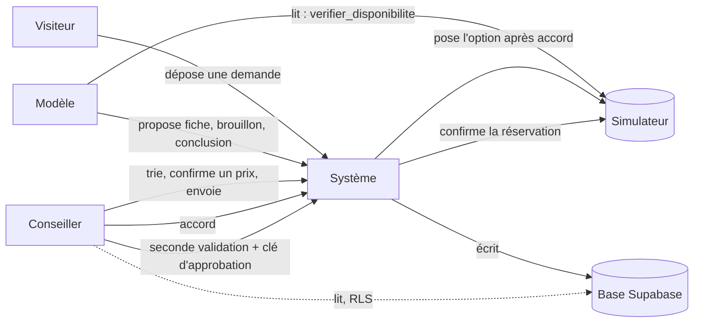

# Schéma des permissions (E9.1)

Qui peut lire, proposer, poser, confirmer. Source de vérité : `types/permissions.ts` ; un test vérifie que cette page, l'outil de l'agent et la matrice des transitions disent la même chose.

**Règle de fond : le modèle lit et propose, le système valide et écrit, le conseiller décide.** Le modèle n'a aucune permission d'écriture, ni en base ni chez le prestataire.

| Action | Nature | Visiteur | Conseiller | Modèle | Système | Condition | Garantie |
| --- | --- | :---: | :---: | :---: | :---: | --- | --- |
| Déposer une demande | écriture | oui | — | — | — | consentements RGPD et IA donnés | route serveur POST /api/demandes ; contrainte CHECK en base |
| Demander une correction de la demande | écriture | — | oui | — | — | dossier à corriger ; deux boucles au plus | fonction SQL demander_correction (service_role) ; unique (dossier, boucle) |
| Corriger sa demande depuis un lien | écriture | oui | — | — | — | lien à usage unique, non expiré (7 jours), dossier encore à corriger | fonction SQL corriger_demande ; seule l’empreinte du jeton est stockée |
| Lire les dossiers, fiches et propositions | lecture | — | oui | — | oui | conseiller connecté avec un profil | RLS lecture_conseiller ; aucune politique pour anon |
| Proposer une fiche ou un brouillon | proposition | — | — | oui | — | le système valide la réponse (FicheIA, BrouillonIA) puis l’écrit | schémas Zod ; le modèle ne reçoit que DemandePourLLM |
| Consulter une disponibilité | lecture | — | — | oui | oui | arguments identiques à la ligne vérifiée | outil unique verifier_disponibilite (OUTILS_AUTORISES) ; contrôle du programme |
| Conclure une vérification (prix, places) | proposition | — | — | oui | — | faits égaux au JSON du simulateur ; sinon réponse invalide | ConclusionVerification ; comparaison des faits (E8.5) |
| Trier, corriger la fiche, confirmer un prix | écriture | — | oui | — | — | transition autorisée par la matrice | cas d’usage côté serveur ; trouverTransition() |
| Envoyer la proposition | écriture | — | oui | — | — | aucune ligne à vérifier ni alerte bloquante | garde de la transition prete → envoyee |
| Donner l’accord pour une option | écriture | — | oui | — | — | proposition depot_recu, vérification ok ; accord à usage unique, valable 10 minutes | transition de création accord_donne ; index unique par ligne |
| Poser une option sur le simulateur | écriture chez le prestataire | — | — | — | oui | accord valide, non expiré, non utilisé | transition accord_donne → posee réservée au système ; CHECK accord_utilise |
| Confirmer une réservation | écriture chez le prestataire | — | oui | — | — | seconde validation : clé d’approbation saisie ; prix de l’option = prix accordé | transition posee → confirmee réservée au conseiller ; CHECK prix en base |
| Annuler une réservation (Could) | écriture chez le prestataire | — | oui | — | — | clé d’approbation saisie et confirmation | transition confirmee → annulee réservée au conseiller |
| Écrire le journal | écriture | — | — | — | oui | en même temps que le changement de statut | fonction de transition unique (E0.7) |

## Secrets

| Secret | Détenteur |
| --- | --- |
| Clé d’équipe du simulateur (X-Team-Key) | serveur (.env) |
| Clé OpenRouter | serveur (.env) |
| Clé service_role Supabase | serveur (.env.supabase) |
| Clé d’approbation | conseiller, saisie à chaque confirmation, jamais stockée |

Aucun secret n'entre dans le contexte du modèle, dans une trace ou dans le navigateur.

## Ce que le modèle ne peut jamais faire

Poser une option, confirmer ou annuler une réservation, écrire en base, modifier un prix, envoyer un message au client. Il n'a pas l'outil pour le faire, et le programme refuse tout autre appel que `verifier_disponibilite` (tests d'E9.6).
